<div align="center">


# Google Apps Script Tools

**Turn the Google Apps Script editor into a modern IDE.**
AI suggestions, in-line errors, multi-file search, GitHub sync, folders, snippets and 50+ themes — without leaving your browser.

[**Install from the Chrome Web Store →**](https://chromewebstore.google.com/detail/google-apps-script-tools/iigobcdpmngdgiacebgenbccmdacnjhp)

<br>

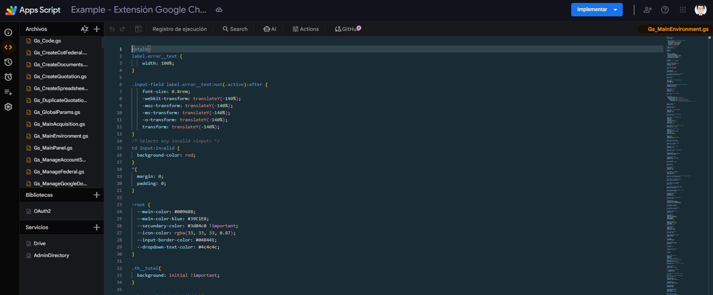

</div>

---

## Why use it

Apps Script is a great runtime, but its editor is missing most of the things you have in VS Code, Cursor or any other modern IDE. This extension fills that gap on top of the tab you already have open.

- **AI suggestions** as you type, with context from your project.
- **AI chat** in Chrome's side panel, with Ask and Agent modes and seven providers (including local models) — bring your own key.
- **Live errors** highlighted right at the line, no save required.
- **GitHub sync** with a three-way diff that tells you whether each change comes from GAS, from GitHub or from both, a full-screen Monaco diff viewer to resolve conflicts, per-file pull and push, and resumable transfers.
- **Folders** in the file tree, with collapsible groups and color icons.
- **File tabs** above the editor, VS Code style (optional): file-colored icons, Apps Script's own unsaved `●` marker, drag to reorder and a list of the tabs that don't fit.
- **Multi-file search** built into the native `Ctrl+F` widget: jump between files and pick any file or match from a list.
- **50+ themes** plus a built-in theme editor and a dark mode for the whole IDE.
- **Snippets** with a built-in catalog and a custom editor.
- **English and Spanish** interface, switchable from the popup header.

Everything is free and works on top of the editor you already use.

---

## Table of contents

1. [Installation](#installation)
2. [Configuration (popup)](#configuration-popup)
   - [Editor options](#editor-options)
   - [Tools](#tools)
   - [Snippets](#snippets)
   - [Themes](#themes)
   - [AI](#ai)
   - [About](#about)
3. [The editor panels](#the-editor-panels)
   - [Active file](#active-file)
   - [File tabs](#file-tabs)
   - [Multi-file search](#multi-file-search)
   - [AI chat](#ai-chat)
   - [GitHub sync](#github-sync)
   - [Project actions](#project-actions)
   - [Live errors](#live-errors)
4. [Keyboard shortcuts](#keyboard-shortcuts)
5. [Privacy](#privacy)
6. [FAQ](#faq)
7. [Credits](#credits)

---

## Installation

Install in one click from the [Chrome Web Store](https://chromewebstore.google.com/detail/google-apps-script-tools/iigobcdpmngdgiacebgenbccmdacnjhp). After install, open any Apps Script project — the toolbar will gain new buttons (AI, current file, actions, GitHub) and the native `Ctrl+F` find widget learns to search across files.

Click the extension icon in Chrome to open the popup with all settings.

---

## Configuration (popup)

Click the extension icon to open the popup. Inside an Apps Script tab it has five tabs: **Editor**, **Tools**, **AI**, **Themes** and **Snippets**, plus a search box that filters every setting of the Editor, Tools and AI tabs. Settings are saved automatically and apply live to any open Apps Script tab.

The header holds three controls that are always available:

- **Master switch** — pauses every feature without uninstalling (the header shows *Paused* while it is off).
- **Language selector** (`EN ▾` / `ES ▾`) — switches the popup between English and Spanish instantly. The toolbar and panels inside Apps Script follow after you reload the Apps Script tab.
- **ⓘ** — opens the [About](#about) screen. Outside the Apps Script editor the popup only shows this screen.

### Editor options

<div align="center">
  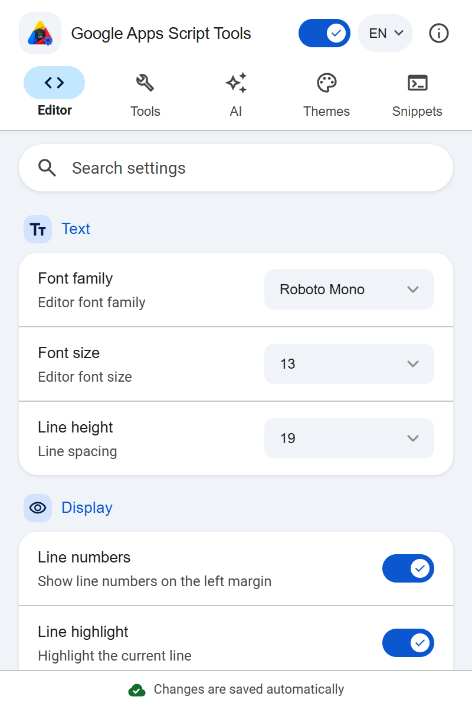
</div>

#### Text

| Option       | What it does                                                                                              | Default       |
| ------------ | --------------------------------------------------------------------------------------------------------- | ------------- |
| Font family  | Editor monospace font: JetBrains Mono, Fira Code, Roboto Mono, Source Code Pro, Geist Mono, IBM Plex Mono and more (loaded from Google Fonts). | `Roboto Mono` |
| Font size    | Editor font size in pixels.                                                                               | `13`          |
| Line height  | Vertical line spacing in pixels.                                                                          | `19`          |

#### Display

| Option                    | What it does                                                            | Default |
| ------------------------- | ----------------------------------------------------------------------- | ------- |
| Line numbers              | Shows line numbers on the left margin.                                  | On      |
| Line highlight            | Highlights the line where the cursor is.                                | On      |
| Show minimap              | Shows the high-level code overview on the right side of the editor.     | Off     |
| Rulers                    | Shows vertical rulers.                                                  | Off     |
| Show whitespace           | Renders spaces, tabs and other invisible characters.                    | Off     |
| Occurrences highlight     | Highlights every occurrence of the word under the cursor.               | On      |
| Indentation guides        | Vertical lines at each indentation level.                               | On      |
| Bracket pair colorization | Paints matching brackets with unique colors so they are easy to follow. | On      |

#### Editing

| Option                | What it does                                              | Default |
| --------------------- | --------------------------------------------------------- | ------- |
| Tab size              | Indentation width: `2`, `4`, `6` or `8`.                  | `2`     |
| Word wrap             | Wraps long lines so they fit within the editor width.     | On      |
| Auto closing brackets | Closes brackets, quotes and tags as you type.             | On      |
| Quick suggestions     | Shows the editor's autocomplete list while typing.        | On      |
| Code folding          | Adds the gutter to collapse code blocks.                  | On      |

#### Cursor & scrolling

| Option                  | What it does                                                                     | Default |
| ----------------------- | -------------------------------------------------------------------------------- | ------- |
| Cursor style            | `Line`, `Block`, `Underline`, `Line thin`, `Block outline` or `Underline thin`.  | `Line`  |
| Cursor blinking         | `Blink`, `Smooth`, `Phase` or `Hidden`.                                          | `Blink` |
| Smooth scrolling        | Animates scroll motion for a more fluid feel.                                    | On      |
| Scroll beyond last line | Lets you scroll past the final line so the cursor can stay vertically centered.  | Off     |

### Tools

#### File explorer

| Option             | What it does                                                                  | Default      |
| ------------------ | ----------------------------------------------------------------------------- | ------------ |
| Custom folders     | Treats `/` in file names as folders in the file tree (e.g. `utils/email.gs`). | On           |
| Folder color       | Color used for folder icons in the file tree.                                 | Neutral grey |
| `.gs` file color   | Color of the icon for Apps Script files (also used in the file tabs).         | Google blue  |
| `.html` file color | Color of the icon for HTML files.                                             | Orange-red   |
| `.json` file color | Color of the icon for JSON files.                                             | Google green |
| File tabs          | Shows the files you open as VS Code-style tabs above the editor ([details](#file-tabs)). | Off |

#### Diagnostics

| Option                  | What it does                                                                                   | Default |
| ----------------------- | ---------------------------------------------------------------------------------------------- | ------- |
| Error lens              | Shows inline diagnostics (errors, warnings, hints) at the offending line.                      | On      |
| Error Lens custom rules | Extra heuristic checks (const reassignment, unreachable code, missing semicolons). May produce false positives. | Off |

#### Advanced (collapsed)

| Option          | What it does                                                                 | Default |
| --------------- | ---------------------------------------------------------------------------- | ------- |
| Debug mode      | Verbose logs in the browser console for troubleshooting.                     | Off     |
| Reset settings  | Restores the Editor and Tools settings to their defaults.                    | —       |

> **Tip:** every option applies live. Open an Apps Script tab in another window to see the effect as you toggle.

---

### Snippets

A built-in catalog of useful snippets for JavaScript and HTML / GAS, plus a visual editor to add your own. Snippets are triggered by their **prefix** in Monaco's autocomplete: type the prefix, press `Tab` and the body expands with placeholders you can jump through.

<div align="center">
  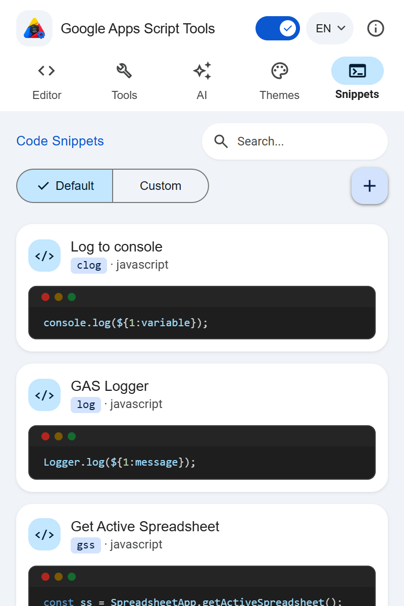
</div>

#### What you can do here

- **Add** a new snippet with title, prefix, language (`javascript` / `html`) and body.
- **Duplicate** any snippet to start from a working template.
- **Edit** any of your custom snippets in a visual form.
- **Delete** custom snippets. Built-in ones are protected so you can't break them.
- **Search** by title or prefix to find a snippet fast.

#### Built-in catalog

**JavaScript**

| Prefix    | Snippet                                                |
| --------- | ------------------------------------------------------ |
| `clog`    | `console.log(variable)`                                |
| `log`     | `Logger.log(message)` (Apps Script logger)             |
| `gss`     | Get active spreadsheet and a sheet by name             |
| `getval`  | Get values from a range (`A2:C`)                       |
| `alert`   | `SpreadsheetApp.getUi().alert(...)`                    |
| `for`     | Classic `for` loop with `i++`                          |
| `forof`   | Modern `for…of` loop                                   |
| `fe`      | `array.forEach(item => { … })`                         |
| `ife`     | `if … else` block                                      |
| `try`     | `try … catch` with `Logger.log` on error               |
| `map`     | `array.map(item => …)`                                 |
| `filter`  | `array.filter(item => …)`                              |
| `doc`     | JSDoc comment block with `@param` and `@return`        |
| `todo`    | `// TODO: …` comment with current date                 |

**HTML / GAS**

| Prefix    | Snippet                                                          |
| --------- | ---------------------------------------------------------------- |
| `htmlgas` | Boilerplate `index.html` for HtmlService, with normalize.css     |
| `field`   | Input wrapped in a label with a placeholder                      |
| `btn`     | Styled button with id and class                                  |
| `select`  | Select dropdown with two options                                 |
| `divc`    | `<div class="container">` block                                  |
| `table`   | Table with `<thead>` and `<tbody>` and two columns               |
| `incjs`   | `<?!= include("JavaScript"); ?>` for HtmlService                 |
| `incss`   | `<?!= include("Stylesheet"); ?>` for HtmlService                 |
| `loader`  | Loading spinner skeleton                                         |

> **Tip:** snippets support placeholders (`${1:name}`) and tab navigation. Type a prefix, press `Tab`, fill the first slot, press `Tab` again to jump to the next.

---

### Themes

Apply any theme with one click. Duplicate any built-in theme to start from a template, edit every color token in the visual editor, or build a new theme from scratch. The **IDE Dark Mode** switch sits at the top of this tab.

<div align="center">
  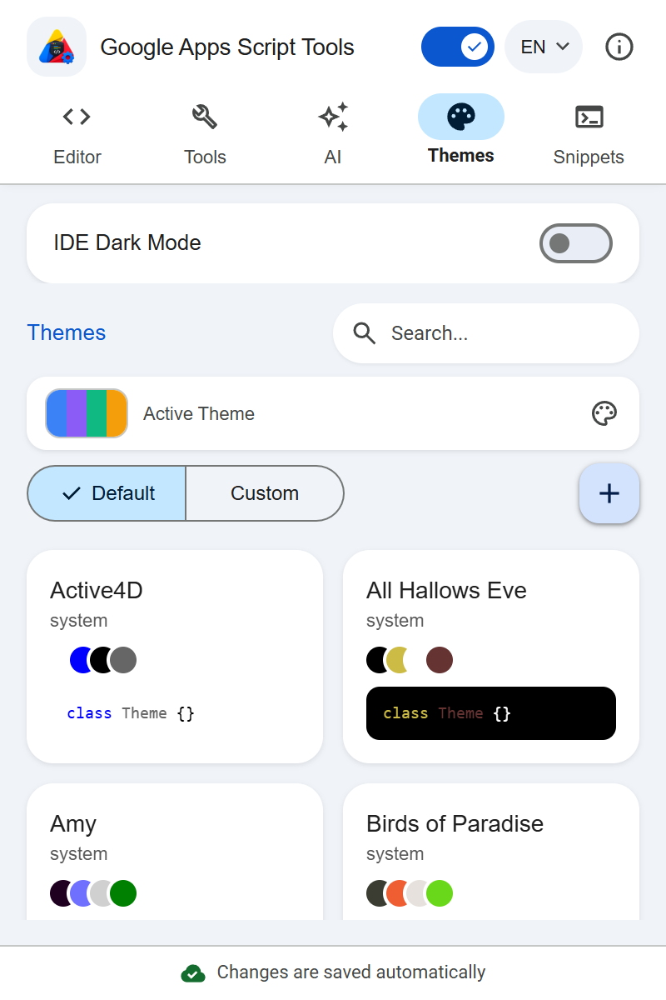
</div>

#### What you can do here

- **Turn on IDE Dark Mode** to apply a dark theme to the whole Apps Script interface, not just the code pane (off by default).
- **Apply** a theme: click any card and it applies live in every open Apps Script tab.
- **Search** themes by name.
- **Duplicate** any theme to base your own design on it.
- **Edit** any custom theme in a visual editor for every token (background, foreground, comments, keywords, strings, types, etc.).
- **Delete** custom themes. Built-in ones are protected.

#### Built-in catalog (51 themes)

| Family            | Themes                                                                                                                                          |
| ----------------- | ----------------------------------------------------------------------------------------------------------------------------------------------- |
| Modern dark       | Dracula, Night Owl, Monokai, Monokai Bright, One you build (start from any), Oceanic Next, Twilight, Vibrant Ink, Sunburst, Upstream Sunburst   |
| Modern light      | GitHub, Solarized-light, Tomorrow, Dawn, Clouds, iPlastic, Chrome DevTools                                                                      |
| Classic VS / IDE  | Xcode_default, Eiffel, Dreamweaver, IDLE, idleFingers, Textmate (Mac Classic), MagicWB (Amiga), monoindustrial                                  |
| Solarized & low   | Solarized-dark, Solarized-light, Zenburnesque, Pastels on Dark                                                                                  |
| Tomorrow set      | Tomorrow, Tomorrow-Night, Tomorrow-Night-Blue, Tomorrow-Night-Bright, Tomorrow-Night-Eighties                                                   |
| Bright / vivid    | Cobalt, Espresso Libre, Birds of Paradise, Amy, Brilliance Black, Brilliance Dull, Active4D, All Hallows Eve, Blackboard                        |
| Designer / warm   | LAZY, krTheme, Kuroir Theme, Katzenmilch, Slush and Poppies, SpaceCadet, Dominion Day, Merbivore, Merbivore Soft, Clouds Midnight               |
| Kiro              | Kiro dark, Kiro light                                                                                                                           |

---

### AI <kbd>⚗️ Experimental</kbd>

The popup's **AI** tab holds the settings shared by every AI feature: inline autocomplete, the language of the answers, a global context for the assistant and the network access granted to each provider. The provider, API key, model and system prompt are set in the [AI chat](#ai-chat) settings (gear icon), which keep the credentials per provider so you can switch with a click.

> **Heads-up.** AI features (chat, autocomplete and the active-file panel that surfaces AI hints) are still **experimental**. They work well in most cases but may behave inconsistently with very large projects, unusual file structures or specific provider models. Disable them from the popup if you hit issues, and feel free to report what didn't work to **rubencho.dev@gmail.com**.

<div align="center">
  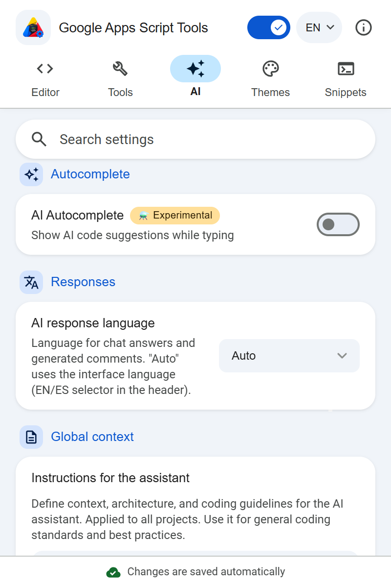
</div>

#### Supported providers

| Provider        | Where to get a key                                         |
| --------------- | ---------------------------------------------------------- |
| OpenAI          | [platform.openai.com](https://platform.openai.com)         |
| Anthropic       | [console.anthropic.com](https://console.anthropic.com)     |
| Google Gemini   | [aistudio.google.com](https://aistudio.google.com)         |
| Nvidia Build    | [build.nvidia.com](https://build.nvidia.com)               |
| ChatLLM         | [apps.abacus.ai](https://apps.abacus.ai)                   |
| OpenRouter      | [openrouter.ai](https://openrouter.ai)                     |
| **Custom (local)** | LM Studio, Ollama or any OpenAI-compatible server on `localhost` / `127.0.0.1` |

#### What you can do here

- **AI Autocomplete** *(experimental, off by default)*: inline ghost-text suggestions while you type; press `Tab` to accept.
- **AI response language**: language for chat answers and generated comments. *Auto* follows the interface language chosen in the header.
- **Global context**: a free-text block with conventions you want the AI to keep in mind in every project (style guide, naming, common helpers).
- **Provider access**: turn on network access only for the providers you use. Chrome asks you to confirm each one, and requests to a provider without access are refused before anything is sent.

In the AI chat settings you pick the provider and model (each provider has its own model list, and *Fetch models* refreshes it), save one API key per provider and edit the system prompt.

#### Use a local model (LM Studio or Ollama)

If you don't want to rely on a paid API, you can run a model on your own machine and connect the extension to it. Pick **Custom** in the provider list and paste the local endpoint URL. The extension talks to any server that exposes an **OpenAI-compatible** chat endpoint, which is the case for both LM Studio and Ollama.

**LM Studio**

1. Download [LM Studio](https://lmstudio.ai) and install it.
2. Open the **Discover** tab, search for `Qwen2.5 Coder 3B Instruct` (recommended) and download it. Any of the models in the table below also works.
3. Go to the **Developer** tab (or **Local Server** in older versions) and click **Start Server**. Default port is `1234`.
4. In the popup, **AI › Provider access**, turn on *Local (Ollama / LM Studio)*. Then, in the AI chat settings (gear icon), set:
   - **Provider:** `Custom`
   - **Endpoint URL:** `http://localhost:1234/v1/chat/completions`
   - **Model:** the exact model id shown in LM Studio (copy from the server panel).
   - **API Key:** leave it empty (LM Studio doesn't require one).

**Ollama**

1. Install [Ollama](https://ollama.com).
2. From a terminal, pull the recommended model:
   ```bash
   ollama pull qwen2.5-coder:3b-instruct
   ```
   Other good options: `stable-code:3b-instruct`, `qwen2.5-coder:7b-instruct`, `llama3.1:8b-instruct`, `deepseek-coder-v2:lite-instruct`. See the table below for trade-offs.
3. Make sure the Ollama service is running (it starts automatically after install on Windows / macOS; on Linux you can run `ollama serve`). Default port is `11434`.
4. In the popup, **AI › Provider access**, turn on *Local (Ollama / LM Studio)*. Then, in the AI chat settings (gear icon), set:
   - **Provider:** `Custom`
   - **Endpoint URL:** `http://localhost:11434/v1/chat/completions`
   - **Model:** the exact model name you pulled (e.g. `qwen2.5-coder:3b-instruct`).
   - **API Key:** leave it empty.

> **Tip:** for code completions a 7B-class instruct model is usually fast enough on a modern laptop and gives decent quality. For chat or refactors, prefer 14B-class if your machine has at least 16 GB of RAM.

#### Recommended local models for Apps Script / JavaScript / HTML / CSS

The author's pick: **`qwen2.5-coder-3b-instruct`**. It is fast even on regular laptops, understands `.gs`, `.html`, `.css` and `.json` well, and is small enough to keep loaded next to your editor. Below are five solid options, ordered from lightest to most capable.

| # | Model                                     | Size  | Strengths                                                       | LM Studio search                | Ollama tag                              |
| - | ----------------------------------------- | ----- | --------------------------------------------------------------- | ------------------------------- | --------------------------------------- |
| 1 | **Qwen2.5 Coder 3B Instruct** *(recommended)* | ~3 B  | Very fast, great quality for its size, strong on JS / HTML / CSS / SQL. | `Qwen2.5 Coder 3B Instruct`     | `qwen2.5-coder:3b-instruct`             |
| 2 | **Stable Code 3B Instruct**               | ~3 B  | Tuned for code completion. Excellent latency for inline ghost-text. | `Stable Code 3B Instruct`     | `stable-code:3b-instruct`               |
| 3 | **Qwen2.5 Coder 7B Instruct**             | ~7 B  | Bigger steps, longer responses, better on tricky refactors.     | `Qwen2.5 Coder 7B Instruct`     | `qwen2.5-coder:7b-instruct`             |
| 4 | **Llama 3.1 8B Instruct**                 | ~8 B  | Strong general-purpose model that also handles JS / HTML well. Use it for chat and explanations. | `Llama 3.1 8B Instruct`         | `llama3.1:8b-instruct`                  |
| 5 | **DeepSeek Coder V2 Lite Instruct**       | ~16 B (MoE) | Best quality of the list. MoE design keeps it fast despite the size; needs ~12 GB of RAM. | `DeepSeek Coder V2 Lite Instruct` | `deepseek-coder-v2:lite-instruct`       |

**How to pick:**

- **Have 8 GB of RAM and want speed?** `qwen2.5-coder:3b-instruct` or `stable-code:3b-instruct`.
- **Have 16 GB and want better answers?** `qwen2.5-coder:7b-instruct` or `llama3.1:8b-instruct`.
- **Have 24 GB+ and want close-to-cloud quality?** `deepseek-coder-v2:lite-instruct`.

> **Note on quantization:** quantized variants like `q4_K_M` are noticeably faster with very little quality loss for code. In LM Studio pick a `Q4_K_M` build of any of the models above; in Ollama the default tag already maps to a sensible quantization.

> **Privacy bonus:** with a local model nothing leaves your machine. The extension talks to `localhost`, the model is on your disk, and there is no cloud call involved.

#### AI Context — short prompts that work

The **AI Context** is a small block of text added to every conversation. Keep it short and specific. Two examples that work well in real Apps Script projects:

```text
This project is a Google Apps Script web app for {YOUR USE CASE}.
- Use modern JavaScript (let / const, arrow functions, async / await).
- Prefer Logger.log over console.log for runtime traces.
- Wrap risky calls in try / catch and log errors with the function name.
- Date format: dd/MM/yyyy. Currency format: 1,234.56 (en-US).
- Keep functions under 40 lines. Comment intent, not syntax.
```

```text
You are pair-programming on Apps Script HTML Service.
- Use <?!= include('Name'); ?> to embed templates.
- Avoid inline event handlers; bind events with addEventListener.
- For Spreadsheet calls, batch reads / writes (getValues / setValues).
- Don't suggest libraries that need npm; only what runs natively in GAS.
```

> **Privacy:** the API key never leaves your browser. The extension talks to the provider directly — no proxy, no telemetry.

---

### About

Open it with the **ⓘ** button in the header. It shows the version, links to the author's GitHub, LinkedIn and email, and statistics: how many custom snippets and themes you have and when the data was last updated. Outside the Apps Script editor this is the only screen the popup shows. The master switch lives in the header, next to the language selector.

<div align="center">
  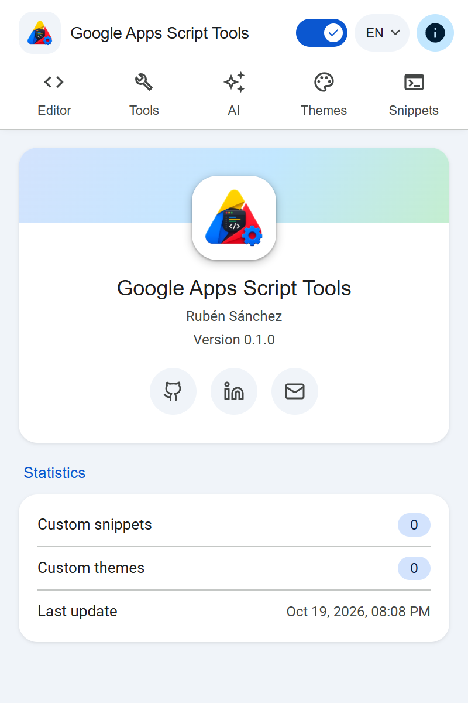
</div>

---

## The editor panels

These are the panels you get inside the Apps Script editor itself, right above the file tree.

### Active file <kbd>⚗️ Experimental</kbd>

A toolbar button that always shows the active file's name — even when the Apps Script tree highlight doesn't reflect it. Click it to open a popover with details.

<div align="center">
  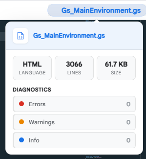
</div>

What you can see and do here:

- **File name** (full path including the virtual folder).
- **Language detected** (Apps Script, HTML, JSON, CSS).
- **Line count** and **size in bytes**.
- **Live counts** of errors, warnings, infos and hints from the linter.
- **Click any error count** to jump to the offending line.

---

### File tabs

Apps Script has no tabs: the file tree is the only way to switch files. Turn on
**Tools › File explorer › File tabs** and every file you open gets a tab above the
editor, as in VS Code. Each tab uses the same colored icon as the file tree (see the
file colors in *Tools › File explorer*).

<div align="center">
  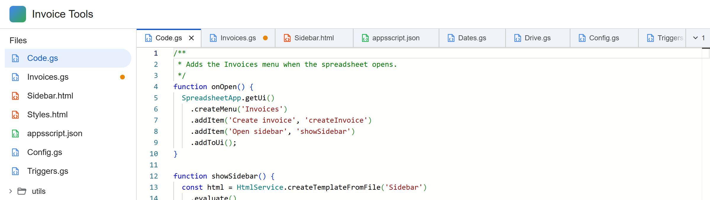
  <br><br>
  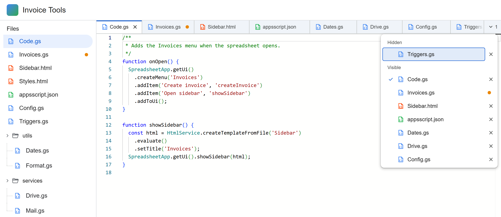
</div>

What you can do here:

- **Click a tab** to switch files — the file tree follows (it also works for files inside collapsed folders). If Apps Script doesn't respond, a message says so and the editor stays on the current file.
- **Close a tab** with its `×` or a middle click. The last tab stays open, because Apps Script always shows a file.
- **Files with unsaved changes can't be closed**: they show a `●` instead of the `×`. *Close others* and *Close to the right* skip them.
- **Right-click a tab** for *Close*, *Close others*, *Close to the right* and *Copy name*.
- **See every open tab** when they don't fit: a button at the right end (`⌄ N`) shows how many are hidden and opens a list with the hidden tabs first (with a filter when there are more than 8 tabs). The edges of the bar fade when there are tabs out of view.
- **Drag tabs** to reorder them, or use `Ctrl+Shift+←/→` on the focused tab.
- **Use the keyboard**: `←/→`, `Home` and `End` move between tabs, `Enter` opens one and `Delete` closes it.
- **See unsaved files** with a `●` dot. When the extension can read Apps Script's own "unsaved" marker in the file tree it uses that, with the same color. Otherwise it's an approximation: it compares each file with its state when it was first seen, and resets after `Ctrl+S`.
- Renaming or deleting a file updates its tab. Files with the same name show their folder next to it (`/` for the root).

Tabs are not kept between reloads. They hide outside the editor view and don't change while the AI change preview is open.

---

### Multi-file search

The native `Ctrl+F` find widget gets an extra bar, right below its inputs, that knows about
the whole project: it shows the file you're standing on and the
position across all files, two chevrons jump to the previous/next file
with matches, and a popover lets you pick any file or any match
directly without stepping through them one by one.

<div align="center">
  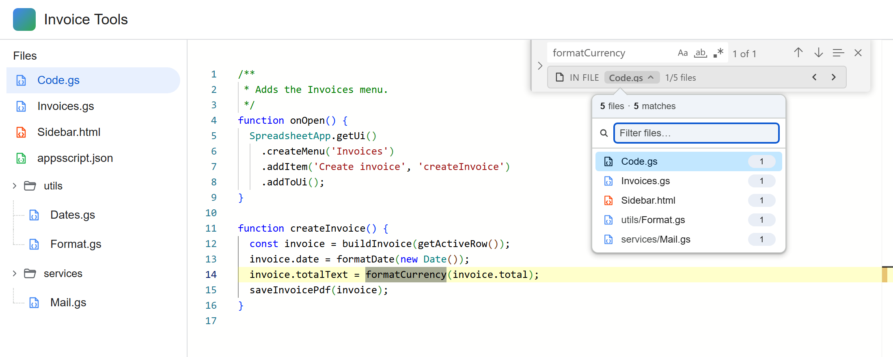
</div>

What you can do here:

- **Press `Ctrl+F`** to open Monaco's native find widget — it works exactly as before.
- **See the active file and position** in the bar below the inputs (e.g. `In file Code.gs · 1/5 files`).
- **Click the file name** to open a popover with every file that has matches, their match counts and the totals; filter and click to jump. The popovers follow the extension's light or dark theme.
- **Click the list icon** to see every match in the current file with its line snippet, and click to jump straight to it.
- **Use `Ctrl+Alt+F` / `Ctrl+Shift+F`** to jump to the next / previous file with matches without leaving the keyboard.
- **All native flags work** — case sensitivity, whole word, and regex.

---

### AI chat <kbd>⚗️ Experimental</kbd>

A chat with your model in Chrome's native side panel, next to the Apps Script editor. Open it with `Alt+Shift+C` or the **AI** button in the toolbar. The panel belongs to the tab: each Apps Script tab keeps its own conversation.

<div align="center">
  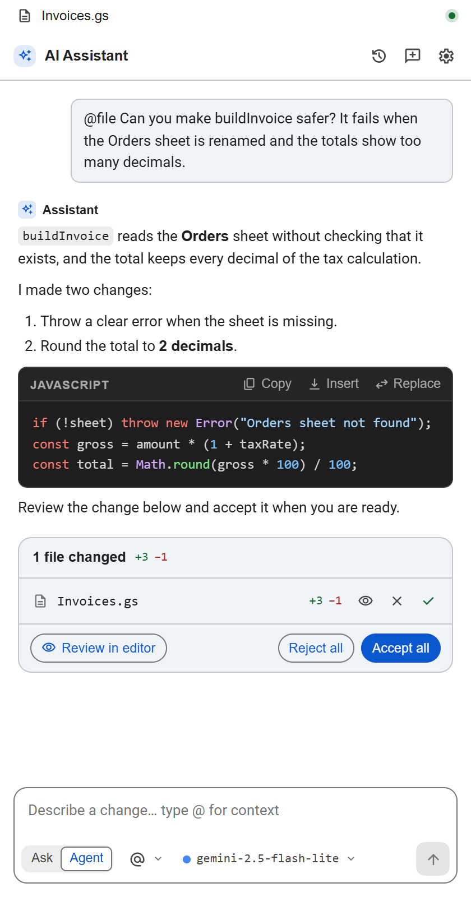
</div>

What you can do here:

- **Talk to the AI** with the conversation history saved per project (up to 30 conversations).
- **Ask or Agent mode**: *Ask* answers and suggests code; *Agent* proposes edits to project files that you review in the chat card and in an in-editor preview before accepting them. Nothing is written without your approval.
- **Switch provider on the fly** from the dropdown at the top.
- **Send context with `@` commands:**
  - `@selection` → send the current selection.
  - `@file` → send the whole file.
  - `@project` → send every file in the project.
- **Code blocks** in responses get three quick actions:
  - Copy to clipboard.
  - Insert at cursor position.
  - Replace the current selection.
- **Edit settings** without leaving the panel: gear icon → provider, API key, model and system prompt. The global AI context and provider access live in the popup's [AI](#ai) tab.

---

### GitHub sync

Connect your GitHub account once and the editor gets a sync panel. Sign in with Google so the extension can read and write your project files via the Apps Script API, then sign in with GitHub via Device Flow. Pick a repo and a branch and you are ready.

<div align="center">
  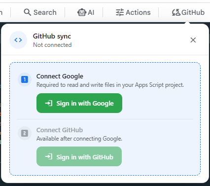
  <br><br>
  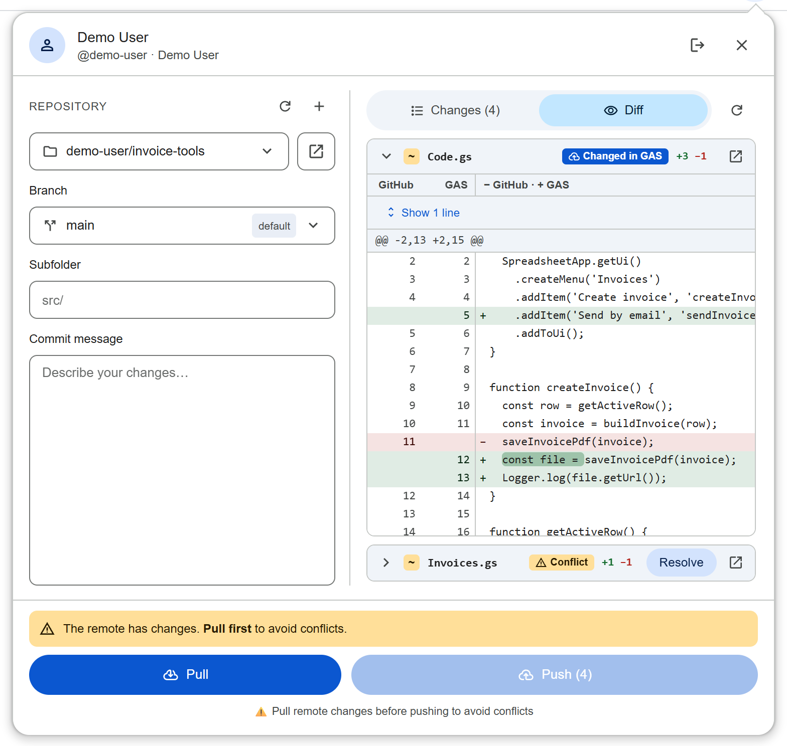
</div>

#### Changes tab — what you can do

- **Browse all pending files** with their status badge (`+` new, `~` modified, `-` only in remote) and **where each change comes from**: *Changed in GAS*, *Changed on GitHub* or *Conflict* (changed on both sides).
- **Select / deselect** files individually or with the master checkbox.
- **Write a commit message** in the inline editor.
- **Push selected files** to the connected branch in a single commit.
- **Pull with control** (see [below](#pull-with-control)).

#### Diff tab — what you can do

- **See the diff per file** in a collapsible card per file, with its exact `+x −y`.
- **Compact unified view**: two line-number columns (**GitHub** on the left, **GAS** on the right), a `@@` header per block, 3 lines of context and collapsed unchanged code (*Show N lines* expands it).
- **Changes inside a line** are highlighted word by word.
- **Per-file origin badge**: the panel remembers the commit of the last successful push or pull (the *sync base*) and compares GAS, GitHub and that base by Git blob SHA, so each file says whether it changed in GAS, on GitHub or on both. Before the first push or pull the origin is *unknown* and a notice says so.
- **Push is only blocked** when a selected file changed on GitHub (or on both sides); changes made only in GAS never ask you to pull first. If the branch moves on GitHub and touches the files you push, the push is refused and the diff is recomputed instead of overwriting.
- **Huge diffs** show a notice instead of being cut silently.
- **Faster**: only the files whose SHA differs are downloaded, 6 at a time.
- **Open any file in the full-screen viewer** with the external-link icon on its card; conflicts also get a *Resolve* button.

#### Full-screen diff viewer

<div align="center">
  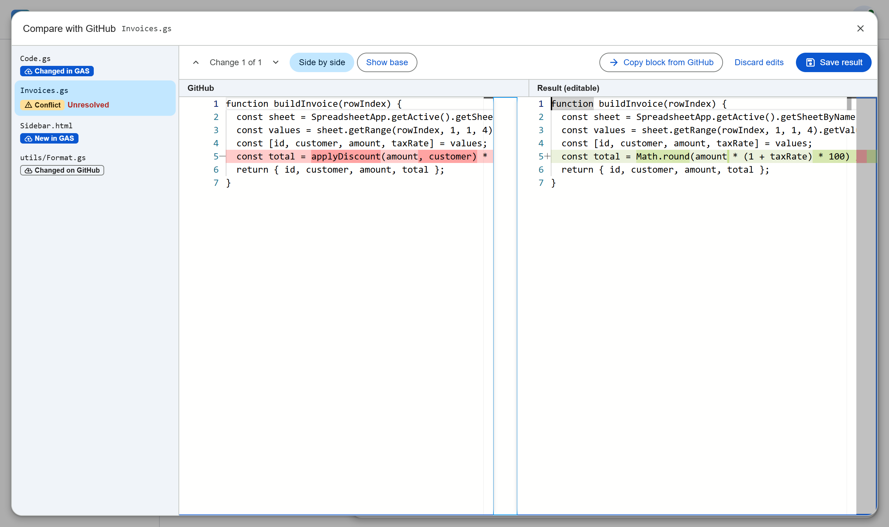
</div>

- **Monaco's diff editor** with GitHub on the left and GAS on the right, a file list with origin badges, side-by-side or inline, previous/next change (`Alt+↑/↓`) and the IDE theme.
- **Decide per file**: *Keep GAS* or *Take GitHub* (each is offered only where it has an effect).
- **Resolve conflicts** with *Edit result*: the right side becomes editable, starting from GAS; copy the block under the cursor from GitHub (*← Copy block from GitHub*), look at the last synced base (*Show base*) and *Save result* — the pull then writes that result. Unsaved edits are kept as a draft if you switch files or close the viewer; *Discard edits* drops them.
- `.gs` files are shown without syntax colors in the viewer so they don't mix with the project's IntelliSense.
- If GAS changes after the comparison, the pull skips that file and asks you to refresh. If Monaco's diff editor is not available, the viewer falls back to a read-only two-column diff: *Keep GAS* and *Take GitHub* still work, but *Edit result* does not.

#### Pull with control

<div align="center">
  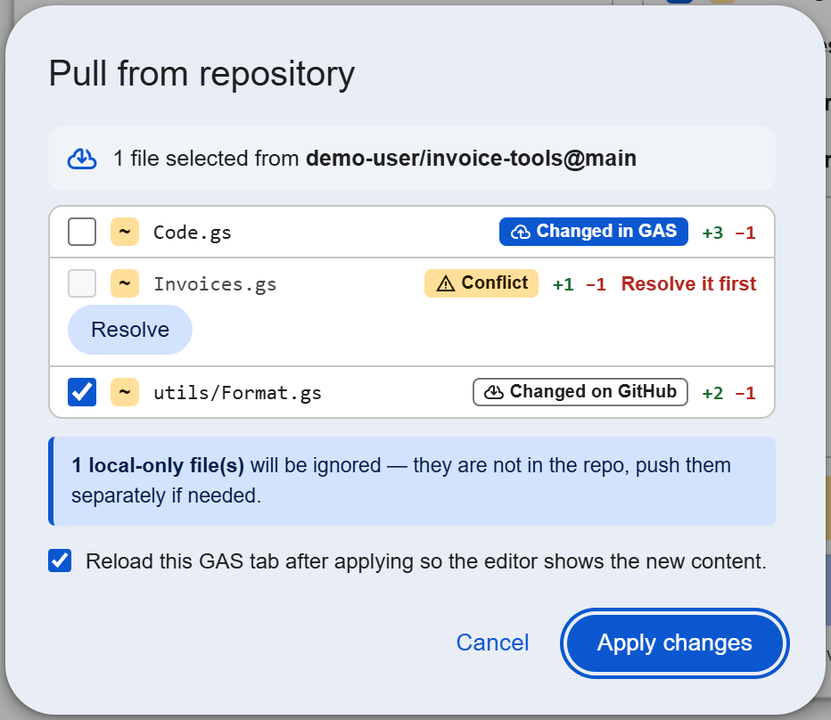
</div>

- **One checkbox per file** with its origin badge and `+x −y`. Files changed on GitHub are selected; files changed only in GAS are not (selecting one warns that it will overwrite your GAS changes).
- **Conflicts need a decision first**: the *Resolve* button opens the viewer; once you take GitHub's version or save a merged result, the file can be pulled. *Keep GAS* leaves it untouched.
- **Files that can't be pulled safely** (too large, not downloaded, incomplete tree or unsafe paths) stay unchecked and say why.
- **Files that only exist in GAS** are never touched by a pull, and you can choose to reload the Apps Script tab after applying.

#### Repository controls

- **Repo selector** with search; create a new repo from inside the panel.
- **Branch selector** with search; create a new branch from inside the panel.
- **Subfolder** field to map the project to a specific subdirectory of the repo.
- **Open repo on GitHub** with the external-link button.

#### Live progress and resumable transfers

Push and pull both show a progress panel anchored at the bottom. You see each file as it goes through:

- **Push:** Reading project snapshot → Uploading file blobs → Building Git tree → Creating commit → Updating branch ref. Each file is checked off in real time with a number.
- **Pull:** Reading remote tree → Downloading file blobs → Merging into project snapshot → Writing back via Apps Script API. Each file is marked as it merges.
- **If something fails halfway** — for example GitHub's secondary rate limit — the panel keeps a record of the files already done. **Retry resumes from there**, marking the reused files with a cache icon, so you don't waste cuota or hit the rate limit twice.
- **The panel cannot be closed and the tab cannot be switched off accidentally** while a sync is in progress: the close button is disabled and the browser shows the native "Leave site?" warning. Once the operation finishes (or fails cleanly), everything goes back to normal.

> **Privacy:** GitHub tokens stay in the browser. Apps Script API tokens are managed by Chrome's identity service. Your code never touches a server we control.

---

### Project actions

A toolbar button that gathers small but useful project tools in one place. Designed to save clicks.

<div align="center">
  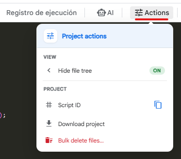
</div>

What you can do here:

- **Download the entire project** as a ZIP for backup or local edition.
- **Open the project in another tab** without losing the current state.
- **Refresh the file tree** when Apps Script doesn't update on its own.
- **Jump to project settings** in one click.
- **Bulk delete files** — select and permanently remove multiple files at once. A file tree with search and checkboxes lets you pick individual files or entire folders. A confirmation step prevents accidents, and a progress panel shows each file as it is deleted via the Apps Script API. After completion, the editor reloads so the sidebar reflects the changes. Requires Google sign-in.

<div align="center">
  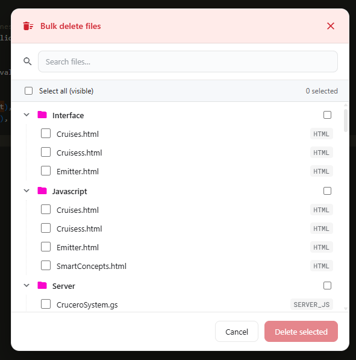
</div>

---

### Live errors

The active file lights up the moment you stop typing. A pulsing dot in the toolbar tells you when there are issues. Click any error to see the message at the offending line — no need to save and run.

The linter detects, among other things:

- Unclosed parentheses, braces or brackets.
- Unterminated strings.
- `==` / `!=` (suggests `===` / `!==`).
- Reassigning a constant declared with `const`.
- Duplicate function parameters.
- Assignments inside `if` / `while` (probable typos).
- Unreachable code after `return` / `throw`.
- Missing semicolons.
- Comparing with `NaN` instead of `Number.isNaN()`.

> **False-positive friendly.** The linter ignores jQuery wildcards (`$('.foo')`), regex literals, template strings and object literals, so you don't get noise on common patterns.

---

## Keyboard shortcuts

| Shortcut         | Action                              |
| ---------------- | ----------------------------------- |
| `Tab`            | Accept the current AI suggestion.   |
| `Ctrl+F`         | Open the native find widget (extended with cross-file navigation). |
| `Ctrl+Alt+F`     | Jump to the next file with matches. |
| `Ctrl+Shift+F`   | Jump to the previous file with matches. |
| `Ctrl+Shift+←/→` | Move the focused file tab left / right. |
| `Alt+Shift+C`    | Open the AI chat panel.             |
| `Alt+Shift+H`    | Open or close the GitHub sync panel. |
| `Alt+↑` / `Alt+↓` | Previous / next change in the GitHub diff viewer. |
| `Esc`            | Close the active panel.             |

---

## Privacy

The extension does not have a server. There is no account to create. Your code, your AI keys and your GitHub token live on your machine.

- No analytics, no tracking, no telemetry.
- AI requests go from your browser straight to the provider you chose.
- GitHub sync goes from your browser straight to GitHub.
- Project sync goes from your browser straight to Google's Apps Script API.
- Settings are stored in Chrome — they sync with your Google account if you have Chrome sync on.
- Open source under the MIT license.

For details, see the [privacy policy](pages/privacy-policy.html) and the [terms of use](pages/terms.html).

---

## FAQ

<details>
<summary><b>Is it really free?</b></summary>

Yes. The extension is free and open source under MIT. The only thing that costs money is the AI itself: you bring your own provider key (OpenAI, Claude, Gemini, etc.) and pay them directly for the usage. We never charge a cent.
</details>

<details>
<summary><b>Do I need to know how to code?</b></summary>

You should be familiar with Apps Script. The extension makes things faster and more pleasant for people already writing scripts. The AI chat helps a lot when you're stuck.
</details>

<details>
<summary><b>Does it slow down the editor?</b></summary>

No. The extension only activates inside the Apps Script editor and runs only the features you turn on. There is a master switch in the popup header to pause everything if you ever need to.
</details>

<details>
<summary><b>Will my code be sent to a server you control?</b></summary>

Never. AI requests go from your browser straight to the provider you chose. GitHub sync goes from your browser straight to GitHub. Apps Script sync goes from your browser straight to Google's API. We do not have a server in the middle.
</details>

<details>
<summary><b>Can I use it on a corporate Google account?</b></summary>

Yes, as long as your organization allows installing extensions from the Chrome Web Store. Some admins block extensions by policy — in that case ask IT to allow this one.
</details>

<details>
<summary><b>Does it work outside Chrome?</b></summary>

Today only on Chromium-based browsers (Chrome, Edge, Brave). The Apps Script editor itself runs there, so that is what we focus on.
</details>

<details>
<summary><b>What happens if a push or pull is interrupted?</b></summary>

The panel keeps track of the files that already finished. When you retry, those files are reused without re-uploading or re-downloading, so you don't waste time or hit GitHub's rate limits twice.
</details>

<details>
<summary><b>How do I create my own snippet or theme?</b></summary>

Open the popup, go to Snippets or Themes, click the **+** button. You'll get a visual editor with a preview while you type. Save and the new item appears in the editor immediately.
</details>

---

## Credits

- **File tree handling:** the idea and approach for the editor's file tree are based on [JeanRemiDelteil / appsScriptColor](https://github.com/JeanRemiDelteil/appsScriptColor).
- **Live linter (Error Lens):** the idea of showing diagnostics at the end of the line is inspired by [usernamehw / vscode-error-lens](https://github.com/usernamehw/vscode-error-lens).
- **GitHub sync via Apps Script API:** the approach for reading and writing the project content from outside the editor is inspired by [leonhartX / gas-github](https://github.com/leonhartX/gas-github/blob/master/src/gas/script-api.js).
- **Native find widget extension:** the idea of extending Monaco's native find widget with cross-file navigation is based on [Black edition for google apps script ide](https://www.swroot.com/black-script).
- **Icons:** SVG paths from [Material Symbols](https://github.com/google/material-design-icons) (Outlined, 24 px, plus a few `Fill` variants) by Google, Apache License 2.0, embedded in `extension/js/shared/gas-ui.js` and used by both the editor panels and the popup. The extension UI loads no external fonts; only the editor font you pick (see *Font family*) is fetched from Google Fonts.
- **Markdown rendering in the AI chat:** [markdown-it](https://github.com/markdown-it/markdown-it) 14.1.0 (MIT), vendored in `src/vendor/markdown-it/` with its license.
- **Code editor in the popup:** [CodeMirror 6](https://codemirror.net/) by Marijn Haverbeke and others (MIT), bundled with its `@lezer/*` dependencies in `src/vendor/codemirror/` with its license.
- **Text diffs:** [jsdiff](https://github.com/kpdecker/jsdiff) 7.0.0 by Kevin Decker (BSD 3-Clause), vendored in `src/vendor/diff/` (license in the file header); used for the word-level highlight in the GitHub diff.

---

## Contact

Questions, feedback or bug reports: **rubencho.dev@gmail.com**.

The repo also has a public issue tracker on [GitHub](https://github.com/rubendariosanchez).

---

## License

MIT — built by [Rubén Darío Sánchez](https://github.com/rubendariosanchez).
